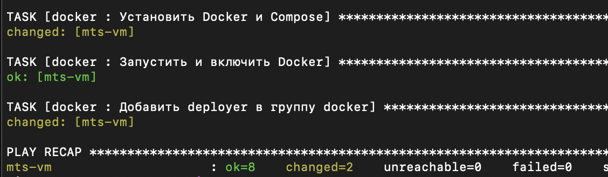
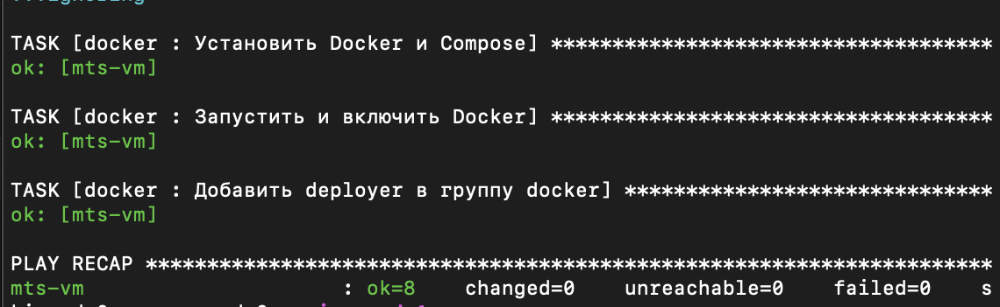
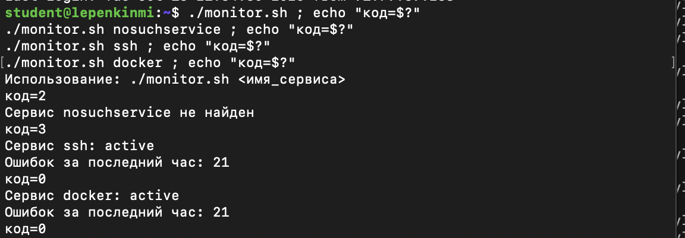
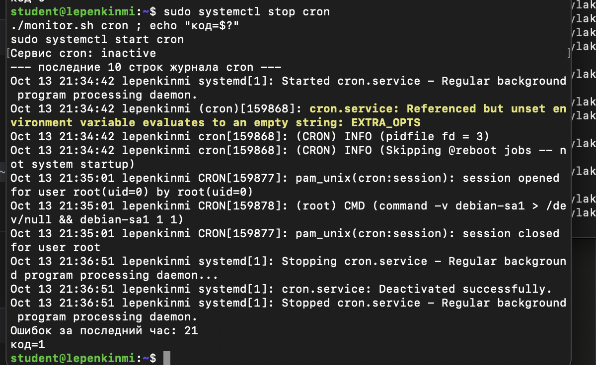
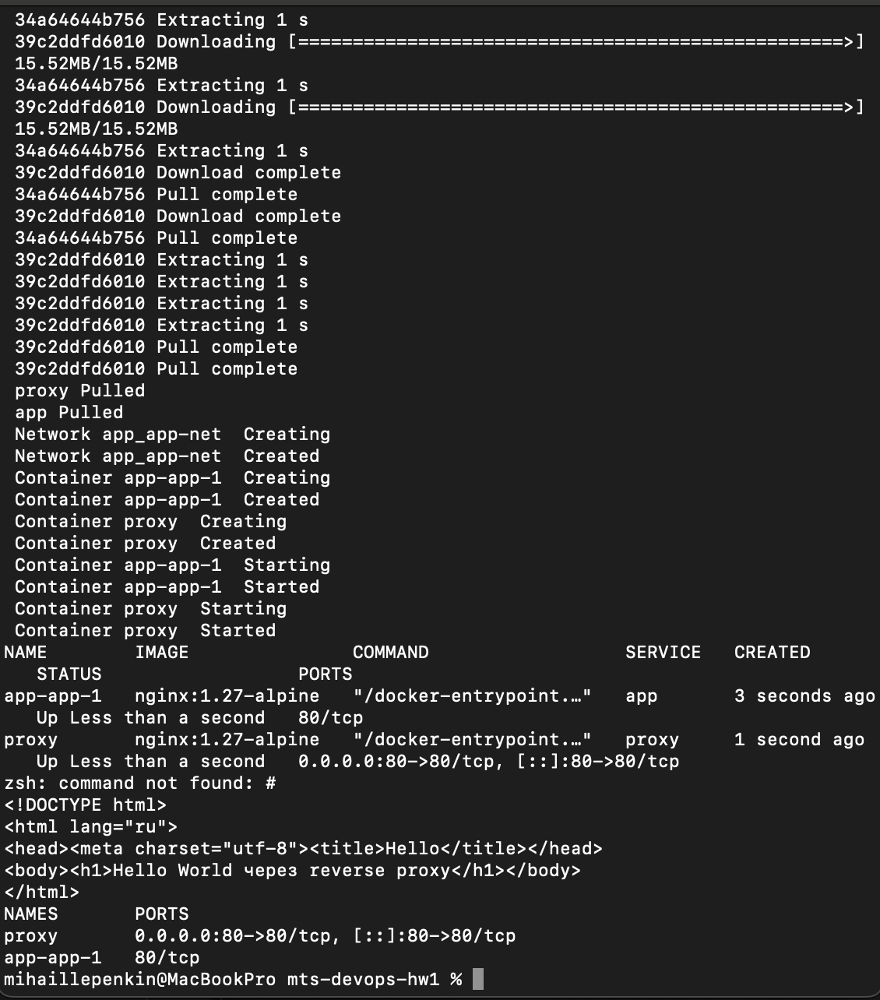
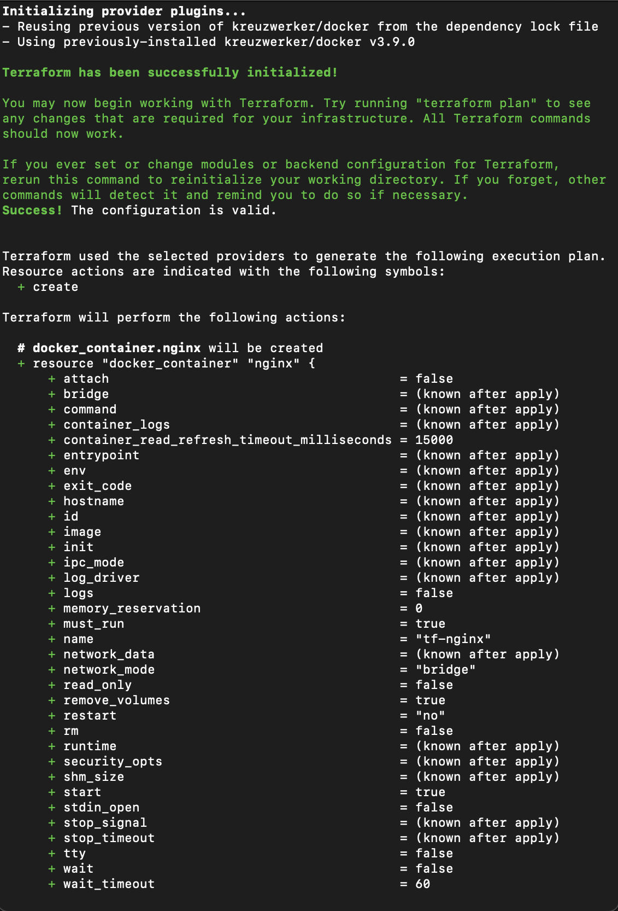
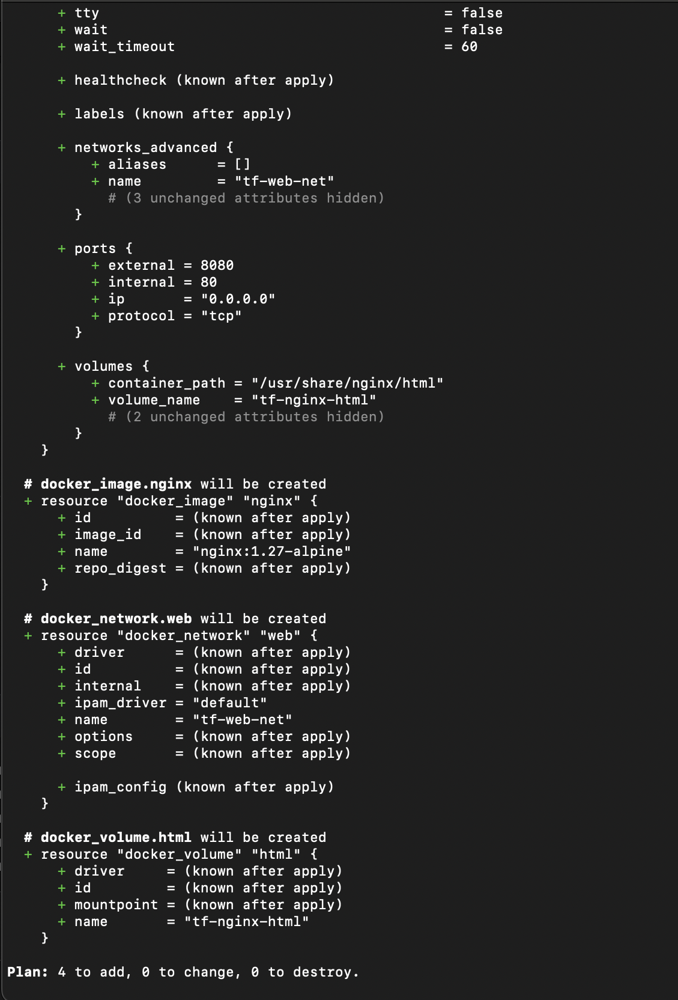
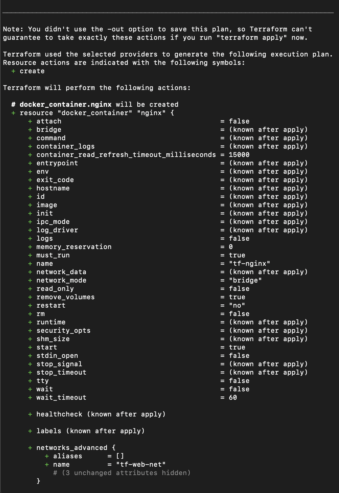
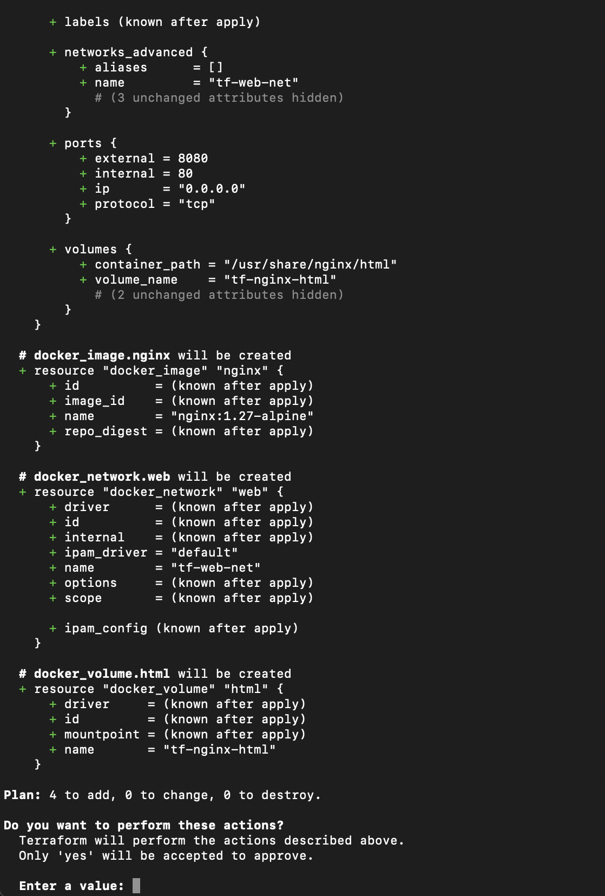
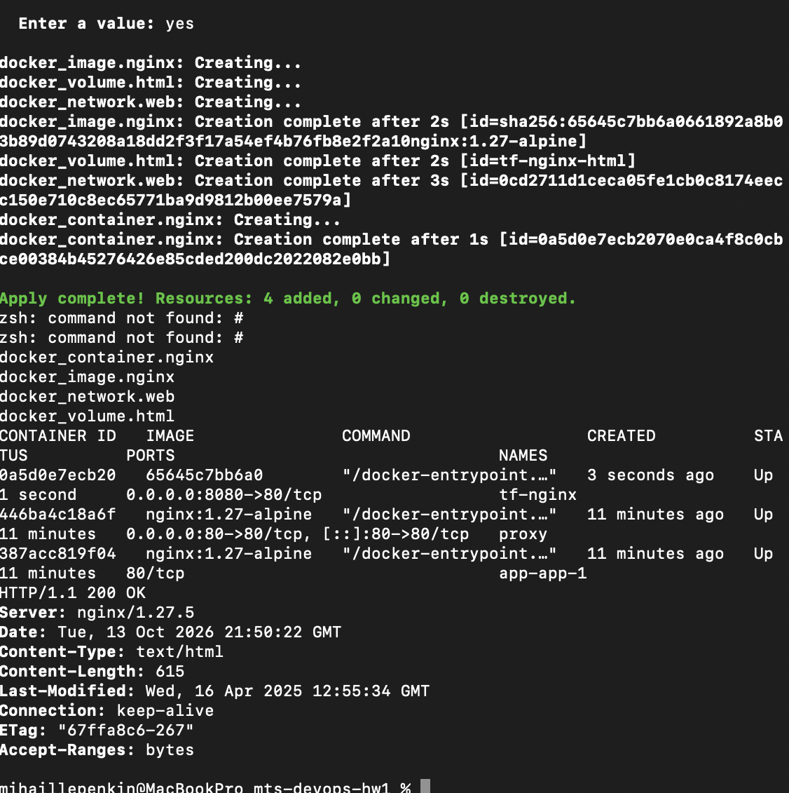

# mts-devops-hw1
Домашнее задание №1 по DevOps: Ansible + Bash-мониторинг + Docker Compose + Terraform.

## Структура репозитория
| Путь | Назначение |
|---|---|
| `ansible/` | плейбук, роли `deployer` и `docker`, inventory |
| `scripts/monitor.sh` | проверка systemd-сервиса и ошибок в syslog |
| `compose/` | reverse proxy + приложение |
| `terraform/` | nginx-контейнер на VM через docker provider |
| `docs/screenshots/` | скриншоты результатов |

## Развёртывание
### 1. Ansible
cd ansible
ansible-playbook setup_host.yml

Повторный запуск даёт changed=0 (идемпотентность).

### 2. Мониторинг
scp scripts/monitor.sh student@$VM_IP:~/
ssh student@$VM_IP './monitor.sh docker'

### 3. Docker Compose
scp -r compose/* deployer@$VM_IP:/opt/app/
ssh deployer@$VM_IP 'cd /opt/app && docker compose up -d'

### 4. Terraform
cd terraform
terraform init
terraform apply

## Результаты
### Ansible: идемпотентность

### Мониторинг: сервис не активен

### Мониторинг: всё в порядке

### Docker Compose

### Terraform

## Архитектурные решения
- Использованы роли Ansible и только встроенные модули для обеспечения идемпотентности (без shell/command).
- Установлен docker.io из репозитория Ubuntu, так как на VM уже мог быть предустановлен containerd.
- Приложение app не публикует порты наружу, доступ осуществляется только через proxy для уменьшения поверхности атаки.
- Terraform подключается к Docker на VM по SSH, state хранится локально и добавлен в .gitignore.

